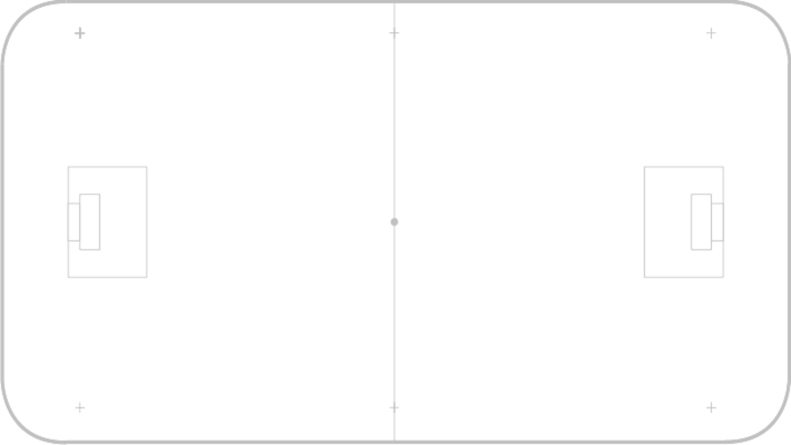

# Hackatohn - AJTY
Hackathon - tým AJTY - cena OLC

# Zapisovatel API

Služba pro hackathonové téma **Moderní rozhraní pro zapisovatele: střely a střídání**.
Vaše aplikace z ní čte utkání, soupisky a předvolby formací a posílá do ní, co zapisovatel
zapsal.

API nestavíte ani neměníte, jen ho používáte. Data mají stejný tvar a pravidla jako
v informačním systému Českého florbalu (FIS).

- Popis všech operací: [`docs/openapi.json`](docs/openapi.json). Běžící služba ho nabízí
  i jako prohlížeč na `/api/docs` (ten potřebuje připojení k internetu).
- Ukázkové odpovědi pro vývoj bez připojení: [`sample-data/`](sample-data/).
- Hřiště, slovník pojmů, jarní prototypy, dnešní formulář: [`podklady/`](podklady/).

## Utkání

Službu si pouštíte sami na svém počítači (viz níže). Běží na `http://localhost:8000`
a přihlašujete se tokenem `demo`. Každé utkání si můžete plnit a mazat, jak chcete
(`POST …/reset` ho vyprázdní).

**Pozor: id hráčů platí jen v rámci jednoho utkání.** Stejný hráč má v jiném utkání jiné `id`,
a po založení nové databáze se id změní. Soupisku a formace proto načítejte vždy pro to
utkání, do kterého zapisujete, a id si nikam nepište natvrdo.

## Spuštění lokálně

```bash
docker compose up
```

Služba běží na `http://localhost:8000`. Tým `demo` v ní má šest utkání:

- **ukázkové utkání** (smyšlené kluby i jména) s připravenými řadami. K němu patří celý
  zaznamenaný zápas v `sample-data/full-match-events.json`;
- **pět skutečných zápasů Livesport Superligy** ze září 2026. Mají jen
  soupisky (jméno, dres, pozice, kapitán), žádné řady a žádné události – přesně tak dostane
  utkání zapisovatel před zápasem. Soubory jsou v `data/matches/`; když tam přidáte vlastní
  soubor ve stejném tvaru a spustíte službu s čistou databází (`docker compose down -v`),
  nahraje se taky.

Seznam vrací `GET /api/v1/matches`. Utkání bez řad vrací z `…/formations` prázdný seznam;
aplikace s tím musí počítat.

Bez Dockeru: `uv sync && ZAPI_DEMO=1 uv run uvicorn app.main:app_from_env --factory --port 8000`.

První tři volání:

```bash
T="Authorization: Bearer demo"
curl -s -H "$T" http://localhost:8000/api/v1/me
curl -s -H "$T" http://localhost:8000/api/v1/matches/1/roster
curl -s -H "$T" -X PUT http://localhost:8000/api/v1/matches/1/events/550e8400-e29b-41d4-a716-446655440000 \
  -H "Content-Type: application/json" \
  -d '{"type":"substitution","team":"home","period":1,"time":"00:00","players":[1,2,3,4,5]}'
```

V ukázkovém utkání jsou hráči 1–5 domácí hráči v poli, takže poslední volání vrátí 201. Ve
vlastní aplikaci berte id ze soupisky. Celý průchod (zápis, oprava, opakované doručení, smazání) ukazuje
`python3 scripts/smoke.py --base-url http://localhost:8000 --token demo`.

## Přihlášení

Každý požadavek nese hlavičku `Authorization: Bearer <token>`. Bez ní nebo se špatným tokenem
vrací služba 401. Volat můžete z prohlížeče z libovolné adresy (CORS je povolený, cookies se
nepoužívají). Token do adresy (`?token=…`) nedávejte, služba ho tam nečte.

## Co se dá číst

| Operace | Co vrací |
|---|---|
| `GET /api/v1/me` | váš tým a jeho utkání |
| `GET /api/v1/codebooks` | číselníky (výsledek střely, poměr sil, posty, pozice ve formaci) a hřiště |
| `GET /api/v1/matches/{id}` | hlavička utkání a hrací části s délkou |
| `GET /api/v1/matches/{id}/roster` | soupisky `home` a `away`: `id`, `jersey`, jméno, `position` (`G` brankář, `D` obránce, `F` útočník), `captain` |
| `GET /api/v1/matches/{id}/formations` | předvolby řad: `lw`, `c`, `rw`, `ld`, `rd` jako id hráče nebo `null` |
| `GET /api/v1/matches/{id}/events` | zapsané události, seřazené podle části, času a pořadí doručení |

V událostech se hráči uvádějí svým **`id` ze soupisky**, ne číslem dresu. Číslo dresu se
u domácích a hostů může shodovat.

## Hřiště a souřadnice



- Souřadnice střely jsou v pixelech tohoto obrázku: `x` 0–890, `y` 0–501, počátek vlevo nahoře.
- **Orientace je pevná po celé utkání: domácí útočí doprava (x ≥ 445), hosté doleva.** Platí
  to ve všech třetinách a bez ohledu na to, na které straně haly týmy zrovna stojí.
- Když si týmy vymění strany, je na vaší aplikaci, jak hřiště zapisovateli ukáže. Do API ale
  vždy posíláte souřadnice v této orientaci. API nic nezrcadlí.
- Střelu z vlastní poloviny API přijme (stává se), ale v odpovědi u ní najdete
  `"warnings": ["shot_from_own_half"]`. Když ho vidíte u většiny střel, máte hřiště obráceně.

## Čas a hrací části

- Čas události je vždy dvojice `period` + `time`.
- `time` je `"mm:ss"` od začátku hrací části, tak jak ho ukazuje časomíra: `"07:42"`. Vždy dvě
  číslice, dvojtečka, dvě číslice. Není to čas z hodin tabletu.
- `period` je číslo části z hlavičky utkání: třetiny 1–3, prodloužení 4.
- Čas musí být menší než délka části: ve dvacetiminutové třetině je poslední platný `"19:59"`.

## Zápis události

Jedna operace pro vytvoření i opravu:

```
PUT /api/v1/matches/{id}/events/{client_id}
```

`client_id` je **UUID, které si aplikace vygeneruje sama** ve chvíli, kdy zapisovatel událost
zadá (`crypto.randomUUID()`). Od té chvíle tu událost označuje navždy.

| Co se stane | Odpověď |
|---|---|
| událost s tímto `client_id` ještě není | 201, `created: true` |
| je tam a posíláte jiný obsah | 200, událost se **upraví**, `version` se zvýší |
| je tam a posíláte stejný obsah | 200, `unchanged: true`, nic se nemění |

Z toho plyne recept na frontu pro práci bez připojení:

1. Událost uložte u sebe (včetně jejího `client_id`) dřív, než ji začnete posílat.
2. Posílejte `PUT`. Když odpověď nepřijde, pošlete ten samý `PUT` znovu – třeba desetkrát.
   Duplicita vzniknout nemůže. Frontu posílejte popořadě; když pro jednu událost čeká starší
   i novější verze, pošlete jen tu novější (bez `version` vyhrává ten zápis, který dorazí
   poslední).
3. Opravu posílejte jako `PUT` na **stejné** `client_id` s novým obsahem. Nezakládejte novou
   událost.
4. Smazání je `DELETE` na to `client_id` (204, opakovaně také 204). Je konečné: další `PUT` na
   smazané `client_id` vrátí 410 `deleted`. „Vrátit smazání“ je nová událost s novým UUID.

Nepovinně můžete v těle poslat `"version": n` – verzi, ze které vycházíte. Když je mezitím
uložená jiná verze **a** posíláte jiný obsah, dostanete 409 `version_conflict` i s aktuálním
stavem události. Bez `version` vyhrává poslední zápis. U nové události se `version` nekontroluje.

Tvar těla se kontroluje jako první: požadavek s neplatným obsahem dostane 422 i tehdy, když
míří na smazanou událost.

### Střela

```json
{
  "type": "shot", "team": "home", "period": 1, "time": "07:42",
  "x": 612, "y": 233, "result": "on_goal", "strength": "even",
  "shooter_id": 6, "goalkeeper_id": 36,
  "assist_id": null, "on_ice": null
}
```

| Pole | Význam |
|---|---|
| `team` | `home` nebo `away` – tým, který střílel |
| `result` | `miss` mimo, `on_goal` na branku (chycená), `post` tyčka, `goal` gól |
| `strength` | poměr sil z pohledu střílejícího týmu: `even`, `power_play` přesilovka, `short_handed` oslabení; výchozí `even` |
| `shooter_id` | střelec, hráč týmu `team` |
| `goalkeeper_id` | brankář soupeře; `null` = prázdná branka nebo neuvedeno |
| `assist_id` | jen u gólu: asistující hráč týmu `team`, jiný než střelec |
| `on_ice` | jen u gólu: `{"home": [id…], "away": [id…]}`, nejvýš 6 na stranu |

### Střídání

Střídání je **sestava, která v daný čas nastoupila** – stejně to drží FIS. Kdo odešel a kdo
přišel, plyne z rozdílu proti předchozímu střídání téhož týmu a API vám to vrátí v polích `in`
a `out`.

```json
{
  "type": "substitution", "team": "home", "period": 1, "time": "08:10",
  "players": [15, 18, 3, 2, 7], "strength": "even", "empty_net": false
}
```

- `players`: 3 až 6 různých hráčů týmu `team`, **bez brankářů**.
- Šest hráčů jen při hře bez brankáře (`"empty_net": true`).
- Tým nemůže mít v jedné části dvě střídání ve stejném čase (409 `duplicate_time`).
- Každá hrací část začíná střídáním v čase `"00:00"` – sestavou, která nastupuje.

Celý skutečný zápas jako seznam požadavků (132 střídání, 55 střel) je
v [`sample-data/full-match-events.json`](sample-data/full-match-events.json).

## Chyby

Každá chyba má stejný tvar:

```json
{"error": {"code": "unknown_player",
           "message": "Hráč 999999 není na soupisce tohoto utkání.",
           "fields": {"shooter_id": "unknown_player"}}}
```

`code` je stabilní a je určený pro program, `message` je česká věta pro člověka, `fields`
(jen u chyb v obsahu) říká, které pole je špatně.

| Stav | `code` | Kdy |
|---|---|---|
| 400 | `invalid_json` | tělo není JSON objekt |
| 401 | `unauthorized` | chybí nebo neplatí token |
| 404 | `not_found` | neznámé (nebo cizí) utkání či adresa |
| 404 | `unknown_event` | událost s tímto `client_id` v utkání není |
| 405 | `method_not_allowed` | adresa tuto metodu nepodporuje |
| 409 | `version_conflict` | událost má mezitím jinou verzi; v odpovědi je její aktuální stav |
| 409 | `duplicate_time` | tým už má v té části střídání ve stejném čase |
| 410 | `deleted` | událost byla smazána |
| 413 | `payload_too_large` | tělo je větší než 16 kB |
| 422 | `validation_error` | tělo má špatný tvar: chybí pole, neznámé pole, špatný typ |
| 422 | `invalid_client_id` | `client_id` není UUID |
| 422 | `invalid_period`, `invalid_time`, `time_out_of_period` | hrací část nebo čas |
| 422 | `unknown_player`, `wrong_team`, `not_goalkeeper` | hráč není na soupisce, je z druhého týmu, není brankář soupeře |
| 422 | `assist_is_shooter`, `goal_fields_on_non_goal`, `out_of_rink` | střela |
| 422 | `too_few_players`, `too_many_players`, `empty_net_required`, `duplicate_player`, `goalkeeper_in_line` | sestava |
| 422 | `type_change` | typ existující události nejde změnit |
| 422 | `event_limit` | utkání má 500 uložených událostí |
| 422 | `forced_rejection` | vynucená chyba (viz níže) |
| 429 | `rate_limited` | moc požadavků; zkuste to za vteřinu (hlavička `Retry-After`) |
| 429 | `too_many_concurrent_requests` | tým má rozpracované 4 požadavky najednou; počkejte na odpovědi |
| 500 | `internal_error` | chyba na straně služby; požadavek jde zopakovat |
| 503 | `forced_unavailable` | vynucená chyba (viz níže) |

Čísla v JSON musí být čísla a texty texty: `"x": "612"` je chyba, stejně jako neznámé pole.

## Vynucená chyba

Dobrá aplikace zapisovateli řekne, že se zápis nepovedl, a o nic nepřijde. Abyste si to
mohli vyzkoušet, umí služba na požádání zápisy odmítat nebo neodpovídat:

```bash
curl -s -H "$T" -X PUT http://localhost:8000/api/v1/me/error-mode \
  -H "Content-Type: application/json" -d '{"mode":"reject"}'
```

| `mode` | Chování |
|---|---|
| `off` | běžný provoz |
| `reject` | každý zápis vrací 422 `forced_rejection`, čtení funguje |
| `unavailable` | všechno vrací 503 `forced_unavailable` |

## Limity

- 20 požadavků za sekundu na token, krátkodobě až 40. Posílejte událost, až je hotová, ne při
  každém doteku.
- Nejvýš 4 rozpracované požadavky jednoho týmu najednou. Frontu posílejte postupně, ne celou
  naráz.
- Tělo požadavku nejvýš 16 kB.
- Nejvýš 500 uložených událostí na utkání (včetně smazaných; `reset` počítadlo vynuluje).
  Skutečný zápas jich má kolem 190.
- Požadavky bez platného tokenu sdílejí jeden malý společný limit.

Na odpověď 429 reagujte tak, že počkáte tolik sekund, kolik říká hlavička `Retry-After`,
a požadavek pošlete znovu. Událost kvůli ní nezahazujte.

## Vývoj bez připojení

`sample-data/` obsahuje odpovědi všech čtecích operací přesně v tom tvaru, v jakém je vrací
API, a ukázky zápisu včetně chyby. Soubory generuje služba sama, takže odpovídají jejímu
chování. Kdo má vrstvu pro API oddělenou od rozhraní, může mezi soubory a živou službou přepínat.

## Pro zvědavé

Kód služby je v `app/` (Python, FastAPI, SQLite), testy v `tests/` (`uv run pytest`), návrh
a důvody rozhodnutí v [`docs/design.md`](docs/design.md). Co porota zkouší u práce s AI, je v [`docs/prace-s-ai.md`](docs/prace-s-ai.md). Jak se v repozitáři pracuje s AI
agentem, popisuje [`AGENTS.md`](AGENTS.md).
